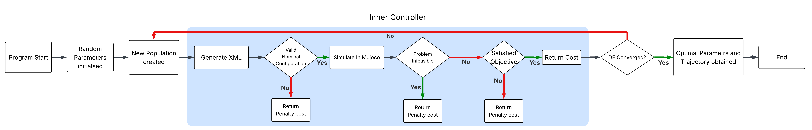

**Summer Internship, U R Rao Satellite Centre (ISRO), Summer 2026**
Co-authored with Suraj Kumar (URSC).

<a class="pdf-link" href="https://arxiv.org/abs/2610.37199">arXiv preprint</a>

## Key Findings

- **Similar ratio, different design.** Both controllers converge to similar thigh-to-shank ratios (1.71 for trajectory optimization, 1.59 for QP), but at different absolute lengths: 0.36/0.21 m vs 0.54/0.34 m. The controller changes the optimal body.
- **Trajectory optimization is the stronger controller.** COT 1.28 vs 1.55 at their respective optima (17% lower), and it wins across most of the design space. Part of this gap may come from the QP gains not being re-tuned per morphology.
- **The asymmetry.** The QP-optimized design loses 14% under trajectory optimization's evaluation; the trajectory-optimized design loses only 3.5% under QP.
- **2D extension.** Angular momentum regulation during stance plus an LQR landing controller produces stable in-place and forward jumps in simulation.

## Problem

In lunar gravity, flight phases are long relative to stance, so attitude can't be fixed through ground reaction forces alone. Leg morphology and controller become interdependent, and the central question is whether the best body depends on the controller used to evaluate it.



## My Contribution

I built the full pipeline: the parametric MuJoCo model, the bi-level framework, both inner controllers, the angular momentum regulated 2D trajectory optimization, and the LQR landing controller with its region-of-attraction sweep.

## Approach

A planar monoped (3 kg base, thigh and shank at constant density, 25 Nm torque limits) must jump 0.2 m. An outer differential evolution loop (PyGMO) proposes thigh and shank lengths. For each candidate, an inner controller attempts the jump in MuJoCo and returns the Cost of Transport.

The two inner controllers:

- **QP task-space controller (QP-TSC):** tracks a liftoff-velocity reference every timestep; it never minimizes energy.
- **Trajectory optimization (CasADi + IPOPT):** direct collocation over the whole stance phase, minimizing positive actuator work.

I used COT rather than raw energy because raw energy rewards small, light legs regardless of efficiency. The energy landscapes in the paper show this bias directly.

## Result 1: 1D Co-Design

| Design optimized with | Evaluated with Traj-opt | Evaluated with QP-TSC |
|---|---|---|
| Trajectory optimization | 1.280 | 1.605 |
| QP-TSC | 1.461 | 1.550 |

The QP-TSC optimum is not physically realistic: its legs would weigh 2.2 kg of a 5.2 kg robot. A real pipeline needs leg-mass-fraction constraints.

## Result 2: 2D Jump and Landing

  
  

| | In-place | Forward |
|---|---|---|
| Apex CoM height (m) | 0.557 | 0.559 |
| Flight time (s) | 0.70 | 0.76 |
| Horizontal displacement (m) | ≈ 0 | 0.20 |
| Peak pitch after touchdown (°) | 17 | 79 |

Landing success depends mostly on where the foot touches down relative to the CoM. The LQR stabilizes a good touchdown pose but cannot recover from a poor one. The forward jump lands with limited margin (79° peak pitch).

## Limitations and Next Steps

Everything is simulation-only, with ideal actuators, one task (0.2 m jump), one gravity, and link lengths as the only design variables. The 2D jump was demonstrated on the baseline morphology (both links 0.3 m), not the co-designed one. Next steps:

- Verify the co-designed morphology in 2D.
- Add actuator models and torque-speed curves.
- Try TV-LQR or MPC landing controllers.
- Extend to lunar terrain.

**Tools:** Python, MuJoCo, CasADi, IPOPT, PyGMO, OSQP, MATLAB

